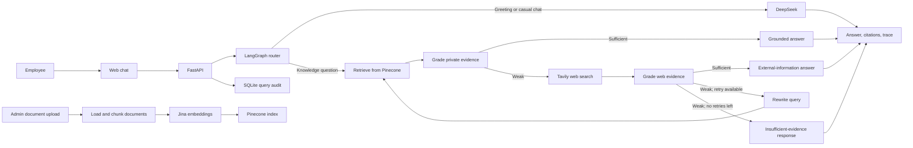

# FDE Agentic RAG Platform

An end-to-end Forward Deployed Engineering (FDE) reference project: a company knowledge assistant that connects an employee-facing workflow to private documents, retrieval infrastructure, language models, public web search, and an auditable API.

The project demonstrates how an FDE solution can move beyond a model demo: it includes document ingestion, an evidence-aware agent workflow, a usable chat interface, operational configuration, and query traceability. The included handbook content is illustrative; adapt the knowledge base, policies, and controls to the organization where the system will run.

## What it does

- Answers employee support and policy questions using a private company knowledge base.
- Routes simple conversation separately from questions that need company knowledge.
- Retrieves relevant document passages and grades whether the evidence is sufficient before answering.
- Uses Tavily as an external fallback when private evidence is weak, and labels external information as such.
- Rewrites and retries an inadequately supported query up to the configured retry limit; returns an explicit insufficient-evidence response rather than inventing an answer.
- Returns source citations and an agent execution trace with each chat response.
- Ingests PDF, TXT, Markdown, and DOCX documents into a Pinecone vector index.
- Writes question, selected source, and workflow trace to a local SQLite audit database.
- Provides a browser-based chat interface and FastAPI/OpenAPI endpoints.

## Architecture



### Request lifecycle

1. The router classifies the request as either a direct conversational response or a company-knowledge question.
2. Knowledge questions are embedded and matched against the configured Pinecone namespace.
3. A grader checks whether retrieved passages support a specific answer. Sufficient evidence is answered from the private knowledge base.
4. If private evidence is weak, the workflow searches the public web, grades those results, and either answers with external citations, rewrites and retries, or returns an insufficient-evidence response.
5. The API returns the answer, source, citations, rewritten query, and trace. The question, source, and trace are also recorded in SQLite.

## Technology

- **API and UI:** FastAPI, Jinja2, HTML, CSS, and JavaScript
- **Agent workflow:** LangGraph and LangChain
- **Language model:** DeepSeek through `langchain-deepseek`
- **Embeddings and vector search:** Jina embeddings and Pinecone
- **Web search:** Tavily
- **Audit storage:** SQLite

## Repository layout

```text
app/
  api/routes.py          Chat, health, and document-ingestion endpoints
  core/                  Settings and logging
  rag/                   Agent state, retrieval, and LangGraph workflow
  services/              Document loading/chunking and SQLite audit log
  main.py                FastAPI application and web UI
data/
  sample_kb/             Illustrative company IT handbook and service desk runbook
static/                  Browser application assets
templates/               Chat page template
ingest_sample_kb.py      Index the bundled sample knowledge base
run.py                   Local development entry point
```

## Getting started

### Prerequisites

- Python 3.10 or later
- API credentials for DeepSeek, Jina, Pinecone, and Tavily
- A Pinecone account with permission to create and use an index

### Install

From the project root, create and activate a virtual environment in PowerShell:

```powershell
py -m venv .venv
.\.venv\Scripts\Activate.ps1
python -m pip install --upgrade pip
pip install -r requirements.txt
```

Create a `.env` file in the project root and configure your provider credentials:

```dotenv
DEEPSEEK_API_KEY=replace-with-your-deepseek-key
JINA_API_KEY=replace-with-your-jina-key
PINECONE_API_KEY=replace-with-your-pinecone-key
TAVILY_API_KEY=replace-with-your-tavily-key

# Change this from the development default before enabling document uploads.
ADMIN_API_KEY=replace-with-a-long-random-secret
```

The settings loader reads `.env` from the project root. Do not commit credentials or share the `.env` file.

### Index the sample knowledge base

```powershell
python ingest_sample_kb.py
```

This loads the example files in `data/sample_kb/`, splits them into overlapping chunks, creates embeddings, and writes the vectors to the configured Pinecone index and namespace. Re-run it after changing the sample documents.

### Start the application

```powershell
python run.py
```

Open [http://127.0.0.1:8000](http://127.0.0.1:8000) for the chat interface. FastAPI's interactive API documentation is available at [http://127.0.0.1:8000/docs](http://127.0.0.1:8000/docs).

## Configuration

All settings can be supplied as environment variables or in the root `.env` file. The names below correspond to fields in `app/core/config.py`.

| Variable | Default | Description |
|---|---|---|
| `APP_NAME` | `FDE Support Agentic RAG` | Application name shown by the service |
| `APP_ENV` | `development` | Environment label |
| `DEEPSEEK_API_KEY` | Empty | Required for routing, grading, and answer generation |
| `DEEPSEEK_MODEL` | `deepseek-chat` | DeepSeek model name |
| `JINA_API_KEY` | Empty | Required to embed queries and documents |
| `JINA_EMBED_MODEL` | `jina-embeddings-v3` | Jina embedding model |
| `EMBEDDING_DIMENSIONS` | `1024` | Embedding and Pinecone index dimension |
| `PINECONE_API_KEY` | Empty | Required for vector storage and retrieval |
| `PINECONE_INDEX_NAME` | `fde-it-support-rag` | Pinecone index name |
| `PINECONE_NAMESPACE` | `company-it-kb` | Namespace used for company knowledge vectors |
| `TAVILY_API_KEY` | Empty | Required for public web fallback |
| `TOP_K` | `4` | Number of knowledge chunks retrieved per query |
| `MAX_RETRIES` | `1` | Maximum query rewrite/retry count after weak web evidence |
| `ADMIN_API_KEY` | `change-me` | Shared secret required by the document-ingestion API; replace before use |
| `AUDIT_DB_PATH` | `data/audit.db` | SQLite query-audit database location |
| `UPLOAD_DIR` | `uploads` | Destination for uploaded source documents |
| `SAMPLE_KB_DIR` | `data/sample_kb` | Source directory used by the sample ingestion script |

Use a dedicated Pinecone index for this application. The current index initialization logic deletes and recreates an existing index if its dimension does not match `EMBEDDING_DIMENSIONS`, which can destroy vectors stored in that index.

## API

### Health

```http
GET /api/health
```

### Ask a question

```http
POST /api/chat
Content-Type: application/json
```

Example request:

```json
{
  "question": "What is our remote work policy?"
}
```

The response includes `answer`, `source_used`, `citations`, `trace`, and `rewritten_query`. The source indicates whether the answer came from the private knowledge base, web search, a direct response, or an insufficient-evidence outcome.

### Ingest a document

```http
POST /api/inngest
X-Admin-Key: <your-admin-key>
Content-Type: multipart/form-data
```

Attach a `file` field. Supported file types are `.pdf`, `.txt`, `.md`, and `.docx`. The endpoint saves the upload, extracts and chunks its contents, and indexes those chunks in Pinecone. It returns the filename, chunk count, and indexed document IDs.

## FDE project in practice

This repository is intended as a working reference for the technical scope of an FDE engagement:

- **Start with a user workflow:** employee support and policy questions are the product surface, not a standalone prompt or model call.
- **Connect to real operational knowledge:** the ingestion pipeline and retrieval index make organization-provided documents usable by the application.
- **Make decisions visible:** the graph trace, selected source, citations, and SQLite audit record expose how a response was produced.
- **Design around evidence quality:** the system grades retrieval, uses a constrained fallback, retries when configured, and has an explicit no-evidence outcome.
- **Deliver an integrated application:** browser UI, API, model and search providers, vector database, and persistent audit storage are wired together.

To adapt it to a real organization, replace the sample documents, define the intended data boundaries and fallback policy, configure access controls, and validate answers against that organization's requirements before deployment.

## Security and deployment notes

This project is a development/reference implementation, not a production security certification.

- Set a unique, high-entropy `ADMIN_API_KEY`; the default value is not safe for deployment.
- The ingestion endpoint uses a shared API key, not user accounts or role-based access control. Put it behind appropriate network and identity controls before exposing it.
- Questions and workflow traces are persisted in SQLite. Establish retention, access, and redaction rules appropriate to the data before using real employee queries.
- Weak private evidence can send the rewritten query to Tavily. Do not submit confidential or sensitive questions unless that external processing is approved.
- Web results are public information and are explicitly intended to be distinguished from company policy.
- Configure and monitor provider access, quotas, error handling, backups, and document lifecycle controls for the deployment environment.

## License

No license is currently specified. Add a license before redistributing or reusing this project outside its intended context.
